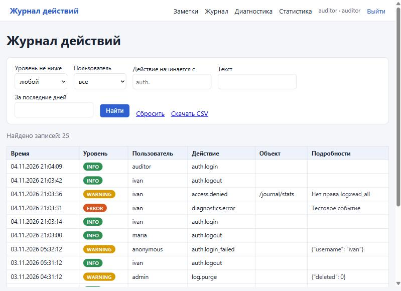
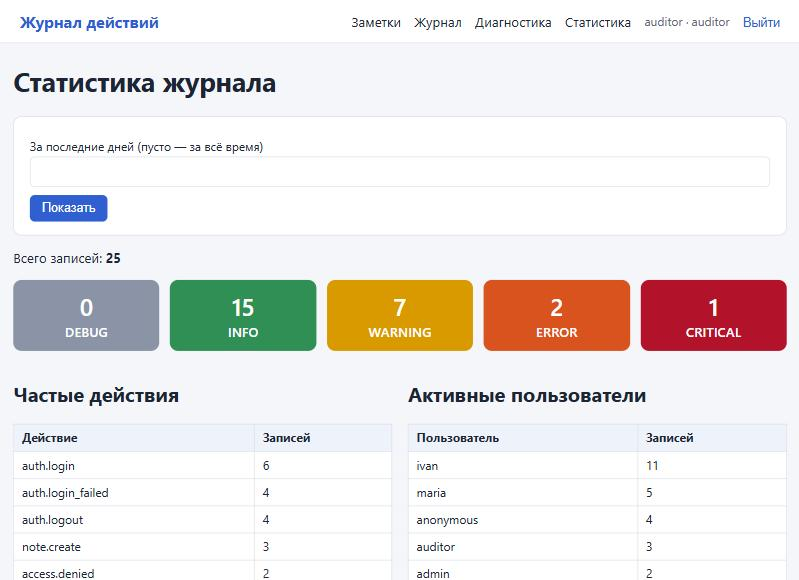
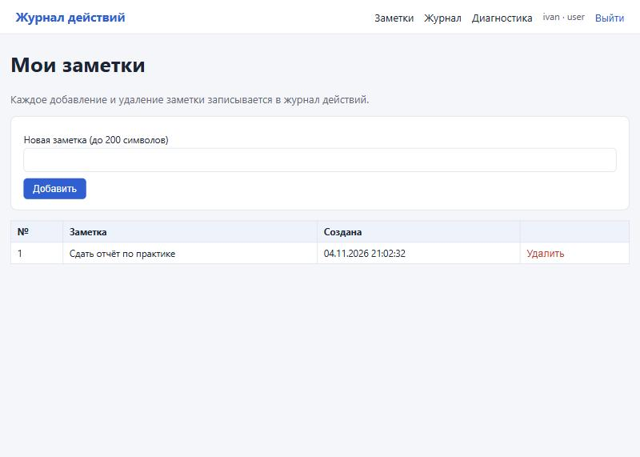
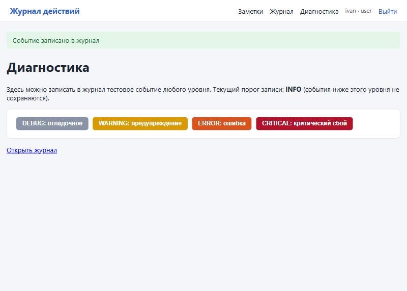

# Журнал действий пользователей


Учебная практика УП 02.02, тема 15: **модуль логирования действий пользователя с уровнями важности**.
В репозитории лежит сам модуль `action_log` и сайт на Flask и Jinja2, на котором он показан.

## Возможности

- запись событий пяти уровней: DEBUG, INFO, WARNING, ERROR, CRITICAL, с порогом записи;
- поиск и фильтры по уровню, пользователю, действию, тексту и времени, постраничный вывод;
- пользователь видит свои записи, аудитор все, администратор ещё и очищает журнал;
- сводка по уровням, выгрузка в CSV, скрытие паролей и токенов в подробностях.

## Архитектура

```
Браузер  ->  Flask (src/app.py, шаблоны Jinja2)  ->  ActionLog (src/action_log)  ->  SQLite
```

```
.
├── .github/            # CI, шаблоны PR и Issue, CODEOWNERS
├── src/
│   ├── app.py          # маршруты Flask, пользователи и заметки
│   ├── seed.py         # демо-пользователи и заметки
│   ├── action_log/     # модуль (запись, чтение, сводка, экспорт, очистка, роли)
│   ├── templates/      # Jinja2
│   └── static/
├── tests/              # тесты модуля и сайта
├── docs/               # ER, UML, требования, QA, ретроспектива
├── CHANGELOG.md
└── requirements.txt
```

Схема данных и диаграммы: [ER](docs/er_diagram.drawio), [Use Case](docs/usecase_diagram.png),
[Sequence](docs/sequence_diagram.png), [нефункциональные требования](docs/nonfunctional_requirements.md).

## Как подключён модуль

Папка `action_log/` скопирована в `src/` рядом с `app.py`. Сайт хранит пользователей и заметки сам, а журнал
(таблицу `log_entries`) ведёт модуль в том же файле SQLite. В `app.py` создаётся один журнал, и маршруты пишут
в него события:

```python
from action_log import ActionLog, Level

journal = ActionLog(db_path="journal.db", min_level="INFO")

journal.info(g.user, "note.create", target="note:5", details={"text": "Купить хлеб"})
journal.warning(anonymous, "auth.login_failed", details={"username": username})
journal.error(g.user, "app.error", details="Не удалось сохранить файл")
journal.query(g.user, min_level="WARNING", limit=15)   # страница «Журнал»
journal.stats(g.user)                                  # страница «Статистика»
```

Права проверяет модуль: обычный пользователь получит только свои записи, статистика и экспорт доступны
аудитору, очистка администратору (исключение `AccessDenied` превращается в страницу 403 и тоже попадает
в журнал как `access.denied`).

## Запуск

```bash
pip install -r requirements.txt
python src/seed.py      # демо-пользователи и заметки, один раз
python src/app.py       # http://127.0.0.1:5000
```

| Роль          | Логин     | Пароль         |
|---------------|-----------|----------------|
| Администратор | `admin`   | `admin12345`   |
| Аудитор       | `auditor` | `auditor12345` |
| Пользователь  | `ivan`    | `user12345678` |
| Пользователь  | `maria`   | `user12345678` |

Это тестовые данные для демонстрации. Порог записи задаётся переменной `LOG_LEVEL` (по умолчанию `INFO`).

## Тесты и проверка стиля

```bash
pytest --cov=src          # 47 тестов, покрытие 94 %
flake8 src tests
black --check src tests
isort --check-only src tests
```

Перед коммитом: `pre-commit install`, после этого проверки запускаются автоматически.

## Скриншоты

| Журнал (аудитор) | Статистика |
|------------------|------------|
|  |  |

| Заметки | Диагностика |
|---------|-------------|
|  |  |

## Процесс

Ветка на задачу `feature/<номер issue>-короткое-имя`, PR по шаблону, ревью у второго участника,
слияние в `main` только после зелёного CI. Версии и изменения: [CHANGELOG](CHANGELOG.md).
